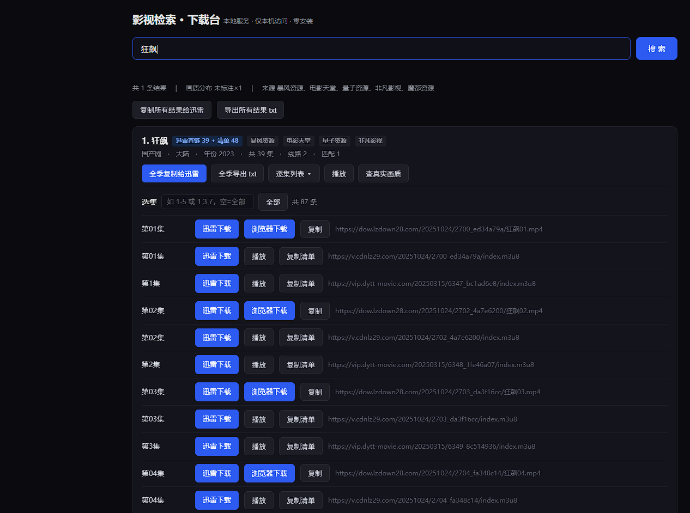
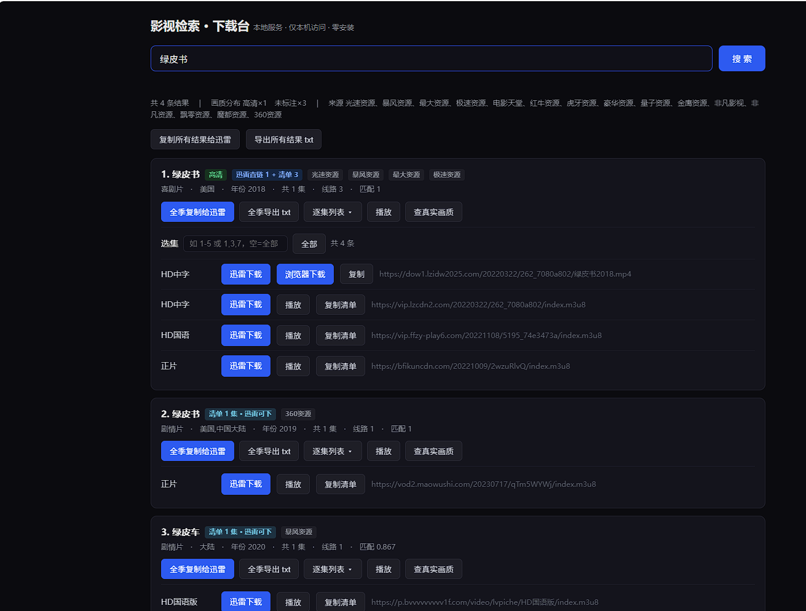

# 影视检索 · FilmSearch

本地影视资源聚合检索工具：输入片名 → 聚合多个公开资源站接口 → **直接给出可下载/可播放的链接**。纯 Python 标准库，零第三方依赖，双击即用。

> ⚠️ **免责声明**：本项目仅用于个人学习与技术交流。项目不存储、不上传、不分发任何视频内容，所有搜索结果均来自公开的第三方站点接口，版权归属原权利方。请支持正版。使用本项目产生的任何问题由使用者自行承担。

| 全季批量下载（狂飙 · 39 集直链） | 多结果对比（绿皮书） |
|---|---|
|  |  |

---

## 功能

- 🔍 **聚合检索**：并发查询 15+ 个公开资源站，3~6 秒出结果，模糊搜索（错别字 / 带年份 / 噪声词都能命中）
- 📥 **一键下全季**：每集直链一键复制，迅雷「新建任务」Ctrl+V 整批开下；支持 `thunder://` 专链、浏览器另存为（断点续传）
- 🎬 **在线播放**：本地代理 + hls.js，浏览器直接看（自动处理 CDN 防盗链）
- 📺 **按集下载**：剧集逐集下载；有 mp4 直链走整文件，没有则自动走 m3u8 拼接
- 🖥️ **网页界面**：搜索、下载、播放、画质查询全在浏览器里完成
- 🧪 **画质打假**：读取 m3u8 里的真实分辨率，识破资源站虚标的「4K」
- ✅ **59 个单元测试** + 前端运行时冒烟

## 快速开始

要求：Windows 10/11 + Python 3.10+（工具本身零第三方依赖）。

### 第 0 步：安装 Python（已装可跳过）

1. 打开 <https://www.python.org/downloads/>，点黄色大按钮下载
   （**不方便访问官网？** 本项目 [Releases](https://github.com/yaohui686/Movie-Search/releases) 页提供了离线安装包，Assets 里直接下载）
2. 运行安装器，**第一屏底部务必勾选 ☑ Add python.exe to PATH**，再点 Install Now
3. 装完重新双击 `影视检索.cmd` 即可

> 💡 双击后秒弹 Microsoft Store？那是系统自带的「假 python」占位：设置 → 应用 → 高级应用设置 → **应用执行别名** → 把 python.exe / python3.exe 两个开关关掉即可。

### 启动

```bat
:: 1. 克隆或直接 Download ZIP 解压
git clone https://github.com/yaohui686/Movie-Search.git
cd Movie-Search

:: 2. 双击启动（或命令行）
影视检索.cmd
```

启动后自动打开浏览器（`http://127.0.0.1:<随机端口>/`），搜索框输入片名即可。

可选增强：

| 组件 | 作用 | 安装 |
|---|---|---|
| ffmpeg | m3u8 拼接出 mp4（无直链源） | `winget install Gyan.FFmpeg`，或放 `bin\ffmpeg.exe` |

## 使用

### 网页版（默认）

| 操作 | 说明 |
|---|---|
| 搜索框输片名 | 实时进度，几秒出结果卡片 |
| **全季复制给迅雷** | 复制该季全部链接 → 迅雷新建任务 Ctrl+V 整批开下 |
| 全季导出 txt | 存一份链接清单备用 |
| 直链列表 | 每集：`迅雷下载`（thunder://）/ `浏览器下载`（另存为+断点）/ `复制` |
| 选集框 | `1-5`、`1,3,7` 按集筛选 |
| 播放 | 本地代理 + hls.js 直接看 |
| 查真实画质 | 显示 m3u8 里写死的真实分辨率 |

### 命令行

```powershell
python run.py                      # 网页版（默认）
python run.py cli                  # 命令行交互模式
python run.py 流浪地球              # 直接查资源
python run.py link 泰坦尼克号       # 只出链接清单
python run.py download 狂飙 -e 1-5  # 按集下载（直链优先）
python run.py play 流浪地球        # 本地播放
python run.py info 泰坦尼克号      # 查真实分辨率
python run.py 流浪地球 --official  # 查正版在哪个平台（豆瓣/爱奇艺/优酷）
```

单字母简写：`l`/`d`/`p`/`o`；中文别名：`链接`/`下载`/`播放`/`正版`/`画质`。

## 工作原理

```
输入片名
  → 查询清洗（去年份/噪声词）→ 多路召回变体
  → 并发查询 N 个资源站接口（6 秒整体截止，慢源丢弃）
  → 片名归一化 + LCS 错别字容忍打分 → 阈值过滤 → 排序去重
  → 每条结果带回：mp4 下载直链 + 每集 m3u8 播放清单
```

- 有整文件直链的源：`thunder://` / 浏览器另存为 / 本地代理流式下载
- 只有播放清单的源：ffmpeg 拼接 mp4，或纯 Python 8 线程拉分片拼 `.ts`
- 播放：本地代理补 `Referer`/`UA` 过防盗链，m3u8 分片改写 + 密钥代理

更多实现细节见 [docs/DEV_NOTES.md](docs/DEV_NOTES.md)。

## 目录结构

```
film-search/
├── 影视检索.cmd        双击启动器
├── run.py              CLI + 子命令入口
├── cfg/app.json        资源站列表（可自行增删）
├── filmsearch/
│   ├── resource.py     资源站聚合检索
│   ├── matcher.py      片名归一化 + 打分（核心）
│   ├── fuzzy.py        查询清洗 / 多路召回
│   ├── webui.py        网页界面（单文件，无前端依赖）
│   ├── webdl.py        下载页 + 代理下载（断点续传）
│   ├── player.py       播放服务（hls.js + 防盗链代理）
│   ├── downloader.py   直链/ffmpeg/纯 Python 三路下载
│   ├── http.py         统一请求层
│   └── report.py       终端表格 / JSON
├── tools/              探活 / 冒烟脚本
└── tests/              单元测试
```

## 常见问题

- **双击启动器报 `[ERROR] exit code 9009` 或秒弹 Microsoft Store？**
  系统里没有可用的 Python（9009 = 命令不存在），或者只有微软放的「假 python」占位。按上面第 0 步安装（记得勾 PATH），或关闭应用执行别名里的 python 两项。仓库根目录的 `Install-Python-Guide.txt` 有图文详解。
- **搜出来的结果标「清单 N 集 · 迅雷可下」没有 mp4？** 该源只提供 m3u8。迅雷对 m3u8 支持边下边播；想要 mp4 装 ffmpeg 后用 `download` 命令自动拼接。
- **播放没反应？** 资源站 CDN 可能失效，换一条结果；或源站域名变了，改 `cfg/app.json`。
- **想加资源站？** 苹果CMS 站点接口格式统一，往 `cfg/app.json` 加 `{"name": "xx", "api": "https://..."}` 即可，用 `python tools/probe_sources.py --write` 探活。

## License

[MIT](LICENSE)
